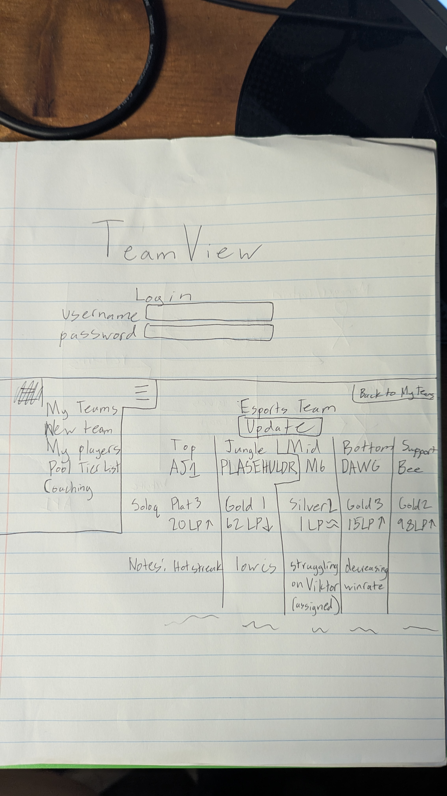
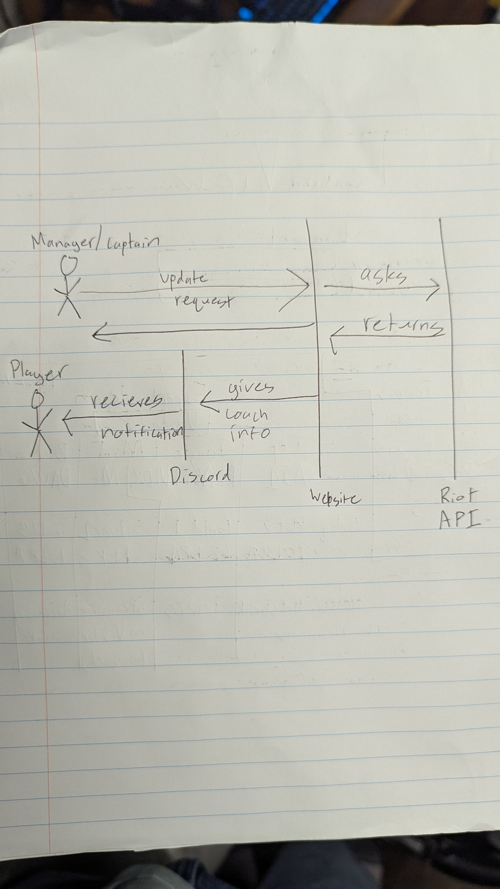

# TeamView

[My Notes](notes.md)

TeamView is a coaching tool for amateur League of Legends teams. The website will allow coaches and team captains to get insights into each players performance within solo queue via Riot API, and have coaching recommendations pushed directly to your team discord server. The program itself will compare recent rank and game performance with historic levels, give insights into drafts and matchups your players don't know how to play, and show each player's greatest individual strengths.

### Elevator pitch

TeamView turns your amateur League of Legends team coaching experience from a disjointed mess of meaningless stats and numbers into a streamlined process completed through just a few clicks. TeamView takes the hard work out of your hands and lets the data speak for itself: showing you the best way to implement large amounts of solo queue data taken directly from the Riot API into your practice.

### Design

### Key features

- Secure login via HTTPS
- Create a team and attach player's accounts to multiple positions, including substitutes
- Pull statistics directly from riot api and compile them into an easy to read summary
- Push improvement stats and coaching plans from the website directly into Discord

### Technologies

I am going to use the required technologies in the following ways.

- **HTML** - Several webpages allowing for the creation and management of teams.
- **CSS** - Application styling that looks good on different screen sizes, uses good whitespace, color choice and contrast.
- **React** - Provides login, team creation/management, buttons to push coaching to Discord/update stats.
- **Service** - Backend Services including:
    - login
    - storage of player statistics to judge improvement of players over a given period
    - retrieval requests to Riot API @ https://developer.riotgames.com/
    - Discord integration
- **DB/Login** - Stores users and their teams in database. Stores players and stats in database. Register and login users. Credentials securely stored in database.
- **WebSocket** - Real-time communication between the backend and coaching dashboard

## 🚀 Specification Deliverable

> [!NOTE]
> Fill in this sections as the submission artifact for this deliverable. You can refer to this [example](https://github.com/webprogramming260/startup-example/blob/main/README.md) for inspiration.

For this deliverable I did the following. I checked the box `[x]` and added a description for things I completed.

- [x] I completed the prerequisites for this deliverable (Git commit requirement)
- [x] Proper use of Markdown
- [x] A concise and compelling elevator pitch
- [x] Description of key features
- [x] Description of how you will use each technology including your 3rd party API and use of WebSocket
- [x] One or more rough sketches of your application. Images must be embedded in this file using Markdown image references.

## 🚀 AWS deliverable

For this deliverable I did the following. I checked the box `[x]` and added a description for things I completed.

- [x] **Rented EC2 server** - I did complete this part of the deliverable.
- [x] **Leased domain name** - I did complete this part of the deliverable.
- [x] **Server accessible** from my domain: [https://teamview.click](https://teamview.click)

## 🚀 HTML deliverable

For this deliverable I did the following. I checked the box `[x]` and added a description for things I completed.

- [x] **Prerequisites** - I completed this part of the deliverable
- [x] **HTML pages** - Added `index.html` (home and login), `teams.html` (team list), `new-team.html` (team creation), `team.html` (team dashboard), `player.html` (player performance), and `coaching.html` (coaching workspace).
- [x] **Proper HTML element usage** - Each page uses semantic `header`, `nav`, `main`, and `footer` elements, with labeled sections, accessible forms, and structured tables where appropriate.
- [x] **Links** - Added navigation between the home, team list, team creation, dashboard, player, and coaching pages.
- [x] **Text** - Added TeamView-specific guidance, example team/player performance, and coaching-plan content based on the startup specification and sketches.
- [x] **3rd party API placeholder** - Documented planned Riot API profile and match-history retrieval on the team dashboard and player profile; no external API request is implemented.
- [x] **Images** - Added original local SVG illustrations for the home, team list, roster, player profiles, and coaching workspace; the home page uses a custom strategy illustration instead of the original sketch.
- [x] **Login placeholder** - Added a login form placeholder on the home page and a clearly labeled demo username on the prototype pages; authentication is not implemented.
- [x] **DB data placeholder** - Added clearly identified static sample team, roster, and performance content; no database connection or persistence is implemented.
- [x] **WebSocket placeholder** - Added disconnected status and example live-update output on the team dashboard and coaching workspace; no WebSocket connection is implemented.

These pages are a static HTML prototype. Forms, authentication, persistence, Riot API access, Discord sharing, and WebSocket communication are documented placeholders for later deliverables.

## 🚀 CSS deliverable

For this deliverable I did the following. I checked the box `[x]` and added a description for things I completed.

- [ ] **Prerequisites** - The home page prominently links to the startup repository, and the AWS deliverable above documents the deployment domain. The current commit history still needs to demonstrate the required development ownership across the deliverable period; do not treat that requirement as complete based on this CSS change alone.
- [x] **Visually appealing colors and layout** - Added a shared dark navy and teal visual theme, readable page hierarchy, styled cards, tables, forms, navigation, footer, and illustrations in `styles.css`.
- [x] **Use of a CSS framework** - Added Pico.css 2 through its jsDelivr stylesheet (not Bootstrap), with TeamView-specific CSS overrides.
- [x] **All visual elements styled using CSS** - Styled page layout, navigation, headings, links, forms, buttons, tables, figures, portraits, status output, and footer with the shared stylesheet.
- [x] **Responsive layout** - Used CSS Grid and Flexbox, fluid sizing, mobile breakpoints, and horizontally scrollable tables for narrow screens.
- [x] **Imported font** - Imported DM Sans and Space Grotesk from Google Fonts.
- [x] **Selector types** - Used element, class, ID, pseudo-class, pseudo-element, attribute, and media-query selectors in `styles.css`.
- [x] **Favicon** - Added a local TeamView SVG favicon and linked it from each HTML page.

The Pico.css framework and Google Fonts are loaded from external CDNs; custom TeamView styling is local in `styles.css`.

## 🚀 React part 1: Routing deliverable

For this deliverable I did the following. I checked the box `[x]` and added a description for things I completed.

- [ ] I completed the prerequisites for this deliverable (Simon deployed, GitHub link, Git commits)
- [ ] **Bundled using Vite** - I did not complete this part of the deliverable.
- [ ] **Components** - I did not complete this part of the deliverable.
- [ ] **Router** - I did not complete this part of the deliverable.

## 🚀 React part 2: Reactivity deliverable

For this deliverable I did the following. I checked the box `[x]` and added a description for things I completed.

- [ ] I completed the prerequisites for this deliverable (Simon deployed, GitHub link, Git commits)
- [ ] **All functionality implemented or mocked out** - I did not complete this part of the deliverable.
- [ ] **Hooks** - I did not complete this part of the deliverable.

## 🚀 Service deliverable

For this deliverable I did the following. I checked the box `[x]` and added a description for things I completed.

- [ ] I completed the prerequisites for this deliverable (Simon deployed, GitHub link, Git commits)
- [ ] **Node.js/Express HTTP service** - I did not complete this part of the deliverable.
- [ ] **Static middleware for frontend** - I did not complete this part of the deliverable.
- [ ] **Calls to third party endpoints** - I did not complete this part of the deliverable.
- [ ] **Backend service endpoints** - I did not complete this part of the deliverable.
- [ ] **Frontend calls service endpoints** - I did not complete this part of the deliverable.
- [ ] **Supports registration, login, logout, and restricted endpoint** - I did not complete this part of the deliverable.
- [ ] **Uses BCrypt to hash passwords** - I did not complete this part of the deliverable.

## 🚀 DB deliverable

For this deliverable I did the following. I checked the box `[x]` and added a description for things I completed.

- [ ] I completed the prerequisites for this deliverable (Simon deployed, GitHub link, Git commits)
- [ ] **Stores data in MongoDB** - I did not complete this part of the deliverable.
- [ ] **Stores credentials in MongoDB** - I did not complete this part of the deliverable.

## 🚀 WebSocket deliverable

For this deliverable I did the following. I checked the box `[x]` and added a description for things I completed.

- [ ] I completed the prerequisites for this deliverable (Simon deployed, GitHub link, Git commits)
- [ ] **Backend listens for WebSocket connection** - I did not complete this part of the deliverable.
- [ ] **Frontend makes WebSocket connection** - I did not complete this part of the deliverable.
- [ ] **Data sent over WebSocket connection** - I did not complete this part of the deliverable.
- [ ] **WebSocket data displayed** - I did not complete this part of the deliverable.
- [ ] **Application is fully functional** - I did not complete this part of the deliverable.
